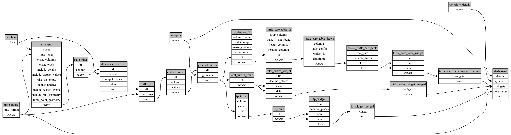

```
# AUTOGENERATED BY ECOSCOPE-WORKFLOWS; see fingerprint in README.md for details

```

```yaml
# fingerprint:
artifacts_sha256_basic: 139a07f0a9e6e444078d5bc906cfd6c93719ab1acc6afacba959809b98eb96d5
artifacts_sha256_strict: b088d4a0328c7c1154dfe42dcf76589685b8ce9af91e39ce859c79f15be4905e
installed_requirements:
- channel: https://repo.prefix.dev/ecoscope-workflows/
  name: ecoscope-platform
  version: {version: ==2.27.1}
- channel: https://repo.prefix.dev/ecoscope-workflows-custom/
  name: ecoscope-workflows-ext-custom
  version: {version: ==0.1.0rc24}
- channel: conda-forge
  name: pydeck
  version: {version: ==0.9.2}
- channel: https://repo.prefix.dev/ecoscope-workflows-custom/
  name: ecoscope-workflows-ext-curacao
  version: {version: ==0.0.8}
params_sha256: aab396cd2520f3d84111563aea802046f28d681986f48c37eb02399556f05564
spec_sha256: db69d4594911376d5b3f081fd33ad3cee7b01468b6fe96e069f0f74932e331c0

```

# ecoscope-workflows-turtles-under-care-workflow


